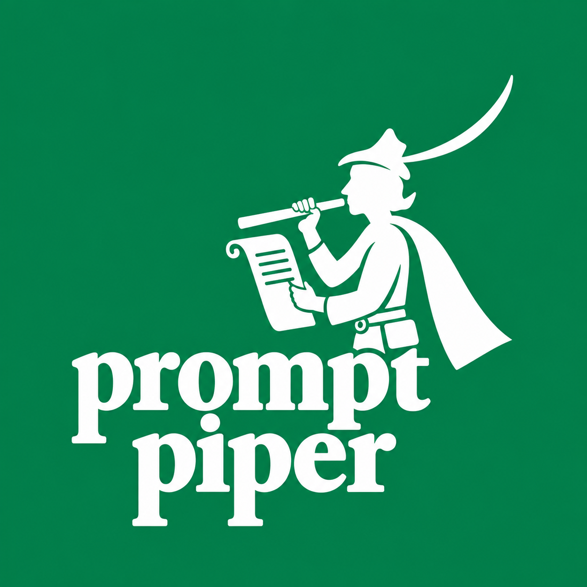

# Prompt Piper



Prompt compression for token-efficient Large Language Models usage.

Prompt Piper searches for the best sequence of text transformations to shorten a prompt while preserving task performance. The search is framed as a multi-objective optimisation problem (minimise token count, maximise task accuracy) solved via evolutionary algorithms (NSGA-II, NSGA-III, MOEA/D).

## Quick start

```bash
# Install dependencies
pip install -e .

# Dry-run (no GPU or API key needed)
python -m prompt_piper.tools.compressor \
    --config resources/configs/example.yaml \
    --dry-run
```

Copy `.env.example` to `.env` and fill in API keys before running real experiments.

## Transformations

28 rule-based operators (O1–O28) in four categories. **Precedence** is the fixed application order (lower = applied first). **Scope** indicates which prompt sections each operator is designed to act on (`instruction` = task description, `shots` = few-shot demonstrations, `data` = input context/question). Note: scope is currently metadata only — all operators are applied to the full `compress_field` text.

| ID | Name | Category | Short Description | Scope | Precedence | Fitted |
|---|---|---|---|---|---|---|
| O1 | RemoveExtraWhitespace | Lexical | Collapse redundant whitespace and blank lines | instruction, shots, data | 1 | — |
| O2 | TrimSpaces | Lexical | Remove leading/trailing spaces from every line | instruction, shots, data | 2 | — |
| O3 | RemoveStopwords | Lexical | Delete non-essential function words | instruction | 3 | corpus |
| O4 | ReplaceWithShortSynonym | Lexical | Replace verbose phrases with shorter equivalents | instruction | 4 | LLM |
| O5 | AbbreviationSubstitution | Lexical | Replace common words with standard abbreviations | instruction, shots | 5 | corpus |
| O6 | SymbolSubstitution | Lexical | Replace words with symbols (e.g. "greater than" → ">") | instruction | 6 | — |
| O7 | ContractionSubstitution | Lexical | Replace expanded forms with contractions (e.g. "do not" → "don't") | instruction, shots | 7 | — |
| O8 | RemovePolitenessMarkers | Lexical | Remove polite phrases that don't affect task semantics | instruction | 8 | — |
| O9 | SentenceMerge | Syntactic | Merge adjacent short sentences into one | instruction | 9 | — |
| O10 | ImperativeRewrite | Syntactic | Convert descriptive task framing to imperative form | instruction | 10 | LLM |
| O11 | EnumerationCompression | Syntactic | Convert bulleted/numbered lists to semicolon-separated form | instruction, shots | 11 | — |
| O12 | ClauseDeletion | Syntactic | Remove non-essential introductory subordinate clauses | instruction | 12 | — |
| O13 | SentenceSimplification | Syntactic | Replace complex syntax patterns with simpler forms | instruction | 13 | — |
| O14 | DeduplicateInstructions | Structural | Remove repeated or near-duplicate instruction sentences | instruction, shots | 14 | — |
| O15 | RemovePromptHeader | Structural | Remove section headers that add no task-relevant content | instruction, shots | 15 | LLM |
| O16 | RemoveMetaText | Structural | Remove meta-sentences that describe the prompt structure | instruction | 16 | — |
| O17 | ContextPruning | Structural | Remove boilerplate instruction paragraphs irrelevant to the task | instruction | 17 | corpus |
| O18 | SectionPruning | Structural | Remove entire named sections from the prompt | instruction, shots | 18 | corpus |
| O19 | ExampleRemoval | Structural | Remove the last few-shot example | shots | 19 | — |
| O20 | ExampleSubsetSelection | Structural | Keep only the first *k* few-shot examples | shots | 20 | — |
| O21 | ExampleSimplification | Structural | Compress verbose input/output examples to compact arrow notation | shots | 21 | corpus |
| O22 | LabelShortening | Structural | Replace verbose output labels with compact abbreviations | instruction, shots | 22 | corpus |
| O23 | ContextCompression | Semantic | Compress per-sample context paragraphs (heuristic: first sentence; LLM: summary) — requires offline preprocessing | — | 23 | — |
| O24 | InstructionSummarization | Semantic | Compress verbose task description to a short instruction | instruction | 24 | — |
| O25 | InstructionAbstraction | Semantic | Replace detailed rule lists with a single abstract instruction | instruction | 25 | — |
| O26 | SchemaEncoding | Semantic | Replace natural-language output-format descriptions with compact schema | instruction | 26 | — |
| O27 | ExampleDistillation | Semantic | Replace few-shot examples with a generalised rule (LLM-backed) | shots | 27 | — |
| O28 | ChunkCompression | Semantic | Compress each paragraph independently (LLM or sub-pipeline) | instruction, shots | 28 | LLM |

## Prompt fields and few-shot compression

Each dataset sample is a dict. The two most important fields are:

| Field | Content |
|---|---|
| `"prompt"` | The fully formatted prompt sent to the model — may include few-shot demonstration examples prepended by lm-eval |
| `"prompt_0shot"` | The same test item formatted without any few-shot examples (instruction + question only) |

`"prompt_0shot"` is **not** a format string with placeholders — it is already fully rendered, just without the demonstration block. The distinction matters when the dataset is loaded with `num_fewshot > 0`.

### Two compression modes

**Compress the full prompt** (default):

```
compress_field = "prompt"   (or omit compress_field)

sample["prompt"]  ──► [transformations] ──► compressed
                                                 │
                                            evaluator + tokenizer
```

Transformations see everything, including any few-shot demonstrations. Operators such as `ExampleRemoval` (O19) or `ExampleSubsetSelection` (O20) can reduce the number of shots.

**Compress only the 0-shot instruction** (protect demonstrations):

```
compress_field = "prompt_0shot"

sample["prompt_0shot"]  ──► [transformations] ──► compressed
                                                        │
                                                   evaluator + tokenizer
```

Transformations only see the instruction and test item. The few-shot demonstrations are never modified. The model is evaluated with the compressed instruction in 0-shot mode.

### Choosing a mode

| Goal | `num_fewshot` | `compress_field` |
|---|---|---|
| Compress a 0-shot prompt | 0 | `null` / omit |
| Compress the instruction only, leave shots untouched | ≥ 1 | `"prompt_0shot"` |
| Compress the entire few-shot prompt as a single block | ≥ 1 | `null` / omit |

### Operator availability by compression mode

Operator effectiveness depends on both the compression mode and the model type. Chat/instruct models must use `compress_field="prompt_0shot"` (the chat template makes `prompt` opaque to text operators). Even with `compress_field="prompt"` on base models, shot-targeting operators rely on plain-text `Input:/Output:` formatting that chat templates break.

| Operator | Base model + `compress_field="prompt"` | Any model + `compress_field="prompt_0shot"` (chat mode) |
|---|---|---|
| O19 ExampleRemoval | ✅ removes last shot | ❌ no-op — no shot blocks in 0-shot text |
| O20 ExampleSubsetSelection | ✅ keeps first *k* shots | ❌ no-op |
| O21 ExampleSimplification | ✅ compacts `Input:/Output:` blocks | ❌ no-op |
| O27 ExampleDistillation | ✅ distils shots to a rule | ❌ no-op |
| O5, O7, O11, O14, O15, O18, O22 | ✅ instruction + shots | ⚠️ instruction part only — shots part is no-op |
| O17 ContextPruning | ✅ instruction paragraphs only | ✅ same |
| O23 ContextCompression | ❌ requires offline preprocessing | ❌ requires offline preprocessing |
| O24–O26, O28 | ✅ | ✅ |

When using chat models with `compress_field="prompt_0shot"`, the four shots-only operators (O19, O20, O21, O27) are completely inert and the effective search space shrinks to 24 active operators.

### Model compatibility

The `"prompt"` field's format depends on how the dataset is loaded. The `"prompt_0shot"` field is **always plain text** regardless of model type (the chat template is intentionally not applied to it, so transformations always operate on a readable string).

| Model type | `compress_field="prompt"` | `compress_field="prompt_0shot"` |
|---|---|---|
| Base HF (GPT-2, Mistral-7B, …) | ✅ plain text, all operators work | ✅ |
| HF instruct/chat (Llama-3-Instruct, Qwen-chat, …) | ⚠️ chat-template markup in `prompt`; structural operators may mangle special tokens | ✅ recommended |
| ChatGPT / OpenAI chat API | ❌ `prompt` is JSON-encoded when `apply_chat_template=True`; transformations cannot parse it sensibly | ✅ required |

**Rule of thumb**: use `compress_field="prompt_0shot"` for any instruct or chat model. Use `compress_field="prompt"` (or omit it) for base/completion models.

### Code example

```python
from prompt_piper.optimization import Experiment, ExperimentConfig
from prompt_piper.backends.lm_eval import LMEvalDataset

# Mode A — compress everything (pure 0-shot task)
config = ExperimentConfig(prompt_field="prompt", n_subset=200)
dataset = LMEvalDataset.from_task("hellaswag", num_fewshot=0).as_list()

# Mode B — protect few-shot demonstrations, compress instruction only
config = ExperimentConfig(
    prompt_field="prompt",
    compress_field="prompt_0shot",
    n_subset=200,
)
dataset = LMEvalDataset.from_task(
    "hellaswag",
    num_fewshot=3,
    template_field="prompt_0shot",   # populates the field in each sample
).as_list()

from prompt_piper.transformations import ALL_TRANSFORMATIONS
exp = Experiment(config, dataset, transformations=ALL_TRANSFORMATIONS)
result = exp.run(baselines=["no_compression", "all_transformations"])
print(result.summary())
```

### YAML config equivalent

```yaml
runs:
  # Compress full prompt (0-shot task)
  - name: hellaswag_full
    task: hellaswag
    num_fewshot: 0

  # Compress instruction only (3-shot task, demonstrations protected)
  - name: hellaswag_0shot_compression
    task: hellaswag
    num_fewshot: 3
    compress_field: prompt_0shot
```

## Dataset-adaptive fitting

`DatasetVocabularyFitter` analyses a corpus of prompts before optimisation and returns transformation instances pre-configured for the dataset's vocabulary and structure:

```python
from prompt_piper.transformations.fitting import DatasetVocabularyFitter

fitter = DatasetVocabularyFitter(train_dataset, seed=42)

# Fit all eligible operators at once
fitted = fitter.fit_all()          # returns {operator_id: instance}

# Or fit a specific subset
fitted = fitter.fit_all(operator_ids=["O3", "O21", "O22"])

# Inspect what was discovered
print(fitter.report())

# Build a factory for use with Experiment
factory = fitter.make_transformation_factory()
result  = Experiment(config, eval_dataset,
                     transformation_factory=factory).run()
```

Corpus-only fitters (no LLM needed): O3, O5, O17, O18, O21, O22.
LLM-backed fitters (pass `backend=` to the constructor): O4, O10, O15, O28.

### Boundary detection

When compressing full prompts that include few-shot demonstrations, the fitter needs to know where the fixed few-shot block ends and the per-sample question begins, so that operators like `ContextPruning` (O17) do not prune the demonstration paragraphs.
Run statistical tests
`DatasetVocabularyFitter.fit_boundary()` detects this boundary automatically via the **longest common prefix** (LCP) across all corpus texts:

```python
fitter = DatasetVocabularyFitter(
    train_dataset,
    compress_field="prompt",      # full-prompt compression
    template_field="prompt_0shot",
)
prefix_text, n_paragraphs = fitter.fit_boundary()
# prefix_text  — the shared instruction + few-shot block
# n_paragraphs — number of blank-line-separated paragraphs to protect
```

The LCP approach uses every sample in the corpus (unlike the older fallback, which only inspected the first sample) and does not require `template_field` to be set — it derives the boundary purely from observed text divergence. It works correctly for base HF models and for `compress_field="prompt_0shot"` with any model type.

`fit_boundary()` is called automatically inside `fit_context_pruning()` and `make_transformation_factory()`, so in most cases you do not need to call it directly. The `template_field` fallback (substring search on the first sample) is retained for corpora where all samples happen to be identical, which makes the LCP degenerate.

## CLI

```bash
# YAML config (recommended for multi-run experiments)
python -m prompt_piper.tools.compressor --config resources/configs/example.yaml

# Dry-run
python -m prompt_piper.tools.compressor --config resources/configs/example.yaml --dry-run

# Single-run
python -m prompt_piper.tools.compressor \
    --model-type hf --model-name mistralai/Mistral-7B-v0.1 \
    --task hellaswag \
    --algorithm nsga2 --pop-size 50 --n-gen 100 \
    --output-dir ./results
```

Results are written as self-contained JSON files under `--output-dir`. Each file includes the full configuration, Pareto-optimal solutions with both search and test objectives, baseline comparisons, and (when fitting was used) the discovered vocabulary patterns.

## ICSE '26 experiments

Preliminary experiments across six benchmarks, run once with a self-hosted model and once with GPT-4o. Results of the submitted paper are archived in `archive/icse_26_submission/`; final results land in `results/icse_26_final/`.

```bash
mkdir -p logs

# Qwen/Qwen3.5-9B (GPU required) — GSM8K, ARC Challenge, MMLU, IFEval, GPQA, BBH
nohup bash scripts/preliminary_run.sh > logs/preliminary_hf.log 2>&1 &

# GPT-4o (requires OPENAI_API_KEY in .env) — same tasks via generative variants
nohup bash scripts/preliminary_run_chatgpt.sh > logs/preliminary_chatgpt.log 2>&1 &
```

Both scripts load `.env` automatically, are restartable (completed runs are skipped), and accept `--dry-run` for a CPU-only smoke test.

## Notebooks

```bash
.venv/bin/jupyter lab
```

- `notebooks/example.ipynb` — basic API walkthrough with a synthetic dataset
- `notebooks/example_llm.ipynb` — full pipeline with an lm-eval task and HF model
- `notebooks/example_llm_complex.ipynb` — multi-run scenario with fitting, few-shot compression, and baselines
- `notebooks/example_chatgpt.ipynb` — same pipeline using ChatGPT via the OpenAI chat-completions API
